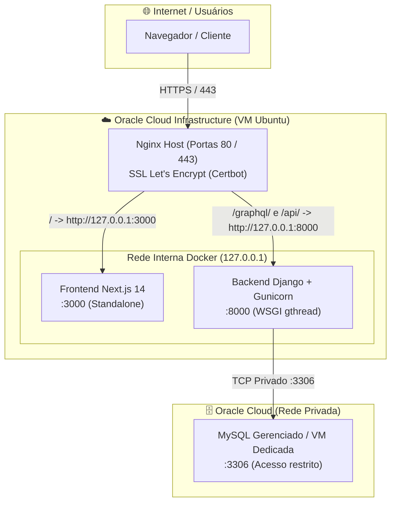
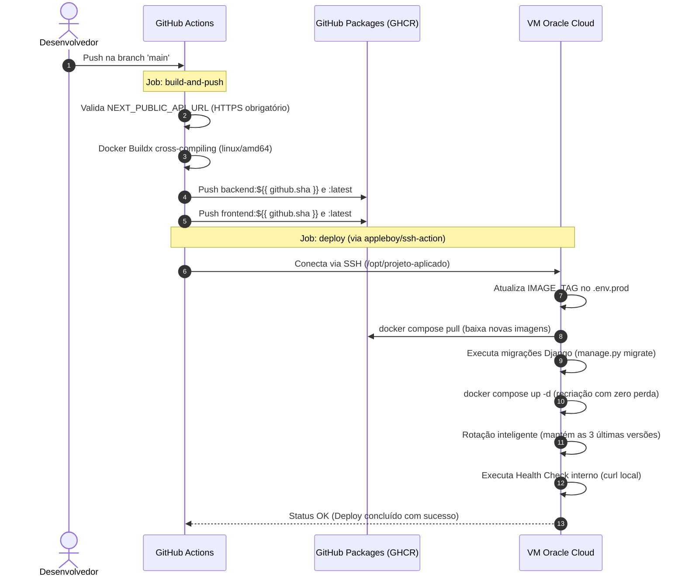

# Projeto Aplicado - Práticas de Mercado

Ambiente fullstack encapsulado utilizando **Docker Compose**, preparado tanto para **desenvolvimento local** quanto para **deploy contínuo em produção na nuvem (Oracle Cloud Infrastructure)**.

O projeto é composto por:
- **MySQL 8.0** (Banco de dados relacional com suporte a UTF-8 e timezone configurado)
- **Django 4.2** (Backend REST/GraphQL com Gunicorn em produção, Allauth OAuth Google, CORS e JWT em cookies seguros)
- **Next.js 14** (Frontend em React com App Router, build standalone otimizado e integração GraphQL)
- **Nginx & Certbot** (Proxy reverso no host com terminação TLS/HTTPS automatizada em produção)

---

## 🏛️ Arquitetura do Sistema



---

## ⚖️ Ambientes: Desenvolvimento vs. Produção

| Componente | Desenvolvimento Local (`docker-compose.yml`) | Produção OCI (`docker-compose.prod.yml`) |
| :--- | :--- | :--- |
| **Banco de Dados** | Container local `mysql:8.0` na mesma rede Docker | Instância MySQL dedicada/gerenciada na Oracle Cloud (IP privado) |
| **Backend Django** | `python manage.py runserver` com volume local montado | Gunicorn (`gthread`, 2 workers, 2 threads) em imagem imutável |
| **Frontend Next.js**| `npm run dev` com hot-reload e código mapeado | Build multistage otimizado (`Dockerfile.prod`) modo standalone |
| **Imagens Docker** | Construídas localmente com `build:` | Baixadas do **GitHub Container Registry (GHCR)** via tag do commit |
| **Plataforma** | Nativa da máquina (ex.: `linux/arm64` no Apple Silicon) | Compilada obrigatoriamente para `linux/amd64` via Docker Buildx |
| **Proxy / TLS** | Acesso direto às portas mapeadas (`:3000`, `:8000`) | Nginx no host com HTTPS forçado via **Certbot (Let's Encrypt)** |
| **Exposição de Portas**| `3000`, `8000`, `3306` abertas no localhost | Apenas `80` e `443` públicas; containers restritos a `127.0.0.1` |

---

## 🚀 Execução em Desenvolvimento Local

### 1. Pré-requisitos
- [Docker](https://docs.docker.com/get-docker/) e [Docker Compose](https://docs.docker.com/compose/) instalados e em execução.

### 2. Configurar Variáveis de Ambiente
Copie o arquivo de exemplo e ajuste se necessário:

```bash
cp .env.example .env
```

### 3. Iniciar todos os serviços
Para construir e iniciar os containers em segundo plano:

```bash
docker compose up -d --build
```

Para acompanhar os logs em tempo real:
```bash
docker compose logs -f
```

### 4. Parar os serviços
```bash
docker compose down
```

Para parar removendo os volumes do banco de desenvolvimento:
```bash
docker compose down -v
```

---

## 🌐 Endpoints e Acessos

### Local (Desenvolvimento)
- **Frontend (Next.js):** [http://localhost:3000](http://localhost:3000)
  - **Dashboard:** [http://localhost:3000/](http://localhost:3000/)
  - **Sign-in:** [http://localhost:3000/sign-in](http://localhost:3000/sign-in)
- **Backend (Django):** [http://localhost:8000](http://localhost:8000)
- **Health Check API:** [http://localhost:8000/api/health/](http://localhost:8000/api/health/)
- **GraphQL API:** [http://localhost:8000/graphql/](http://localhost:8000/graphql/)
- **Django Admin:** [http://localhost:8000/admin/](http://localhost:8000/admin/)
- **MySQL Local:** `localhost:3306`

### Produção (Oracle Cloud + DuckDNS)
- **Aplicação Web:** `https://seu-dominio.duckdns.org`
- **GraphQL API:** `https://seu-dominio.duckdns.org/graphql/`
- **Health Check API:** `https://seu-dominio.duckdns.org/api/health/`

---

## 🔄 Pipeline de CI/CD (GitHub Actions)

A automação de entrega e implantação contínua está implementada em [.github/workflows/ci-cd.yml](file:///.github/workflows/ci-cd.yml) e é disparada automaticamente a cada `push` na branch `main`.

### Fluxo do Deploy Automatizado



### Secrets e Variáveis do GitHub (Ambiente `prod`)

Para que o pipeline funcione, configure em **Settings > Secrets and variables > Actions > Environment: `prod`**:

| Nome do Secret | Descrição |
| :--- | :--- |
| `GHCR_PAT` | Personal Access Token com permissões `write:packages` e `read:packages` |
| `ORACLE_HOST` | Endereço IP público ou hostname da VM Oracle Cloud |
| `ORACLE_USER` | Usuário de acesso SSH na VM (ex.: `seu_usuario_ssh`) |
| `ORACLE_SSH_PRIVATE_KEY` | Chave privada SSH autorizada em `~/.ssh/authorized_keys` da VM |
| `NEXT_PUBLIC_API_URL` | URL completa da API em HTTPS (ex.: `https://seu-dominio.duckdns.org`) |

---

## ⏪ Estratégia de Rollback Automatizado

Em caso de incidentes em produção, o workflow [.github/workflows/rollback.yml](file:///.github/workflows/rollback.yml) pode ser disparado manualmente via interface do GitHub Actions (**Run workflow**):

- **Estratégia `head_1` (Automática):** Identifica a versão anterior que já está no cache local do Docker da VM e volta para ela imediatamente, sem necessidade de novo download.
- **Estratégia `manual`:** Permite especificar qualquer SHA de commit para o qual se deseja retornar.
- Ambos os modos atualizam o `.env.prod`, forçam o recreate dos containers (`--force-recreate`) e validam o health check após o procedimento.

---

## 🖥️ Configuração do Servidor de Produção (Oracle Cloud VM)

### 1. Estrutura de Diretórios na VM
```bash
sudo mkdir -p /opt/projeto-aplicado
sudo chown -R $USER:$USER /opt/projeto-aplicado
```

Arquivos necessários em `/opt/projeto-aplicado`:
- `docker-compose.prod.yml` ([código de referência](file:///docker-compose.prod.yml))
- `.env.prod` (com permissões restritas: `chmod 600 .env.prod`)

> [!IMPORTANT]
> **Atenção aos caracteres `$` no `.env.prod`:** O Docker Compose tenta interpolar variáveis que contenham o caractere `$`. Caso a sua `DJANGO_SECRET_KEY` possua `$`, você deve duplicá-los como `$$` no arquivo (ex.: `minha$$chave$$exemplo$$secreta`).

### 2. Nginx do Sistema Operacional (Proxy Reverso)
O arquivo de configuração do Nginx no SO hospedeiro (ex.: `/etc/nginx/sites-available/projeto-aplicado` ou baseado em [app.conf](file:///app.conf)):

```nginx
server {
    listen 80;
    server_name seu-dominio.duckdns.org;

    # Frontend Next.js
    location / {
        proxy_pass         http://127.0.0.1:3000;
        proxy_http_version 1.1;
        proxy_set_header   Upgrade $http_upgrade;
        proxy_set_header   Connection 'upgrade';
        proxy_set_header   Host $host;
        proxy_set_header   X-Real-IP $remote_addr;
        proxy_set_header   X-Forwarded-For $proxy_add_x_forwarded_for;
        proxy_set_header   X-Forwarded-Proto $scheme;
        proxy_cache_bypass $http_upgrade;
    }

    # Backend GraphQL
    location /graphql/ {
        proxy_pass         http://127.0.0.1:8000/graphql/;
        proxy_set_header   Host $host;
        proxy_set_header   X-Real-IP $remote_addr;
        proxy_set_header   X-Forwarded-For $proxy_add_x_forwarded_for;
        proxy_set_header   X-Forwarded-Proto $scheme;
    }

    # Health Check
    location /api/health/ {
        proxy_pass         http://127.0.0.1:8000/api/health/;
        proxy_set_header   Host $host;
    }
}
```

### 3. Emissão e Renovação de Certificado SSL/TLS
```bash
sudo certbot --nginx -d seu-dominio.duckdns.org
```

### 4. Firewall e Proteção com Fail2Ban (Princípio do Menor Privilégio)

A infraestrutura na Oracle Cloud aplica o **Princípio do Menor Privilégio (Least Privilege)** para exposição de portas:

- **Security List / NSG (Regras de Entrada Públicas):**
  - `80/TCP`: HTTP (redirecionado automaticamente para HTTPS pelo Nginx)
  - `443/TCP`: HTTPS (tráfego da aplicação web e GraphQL)
  - `22/TCP`: SSH (porta administrativa de gerência sob proteção ativa do Fail2Ban)
  - Portas internas (`3000`, `8000`, `3306`): **bloqueadas externamente**, restritas à rede local e ao IP privado da VCN.

- **Proteção da Porta 22 (SSH) com Fail2Ban:**
  Configurado com tolerância de **4 erros** e tempo de banimento de **24 horas**:

  ```ini
  # /etc/fail2ban/jail.local
  [DEFAULT]
  bantime = 24h
  findtime = 10m
  maxretry = 4

  [sshd]
  enabled = true
  port = 22
  mode = aggressive
  backend = systemd
  ```

  Para verificar o status ativo do Fail2Ban na VM:
  ```bash
  sudo fail2ban-client status sshd
  ```

---

## 🔐 Como utilizar o JWT no DRF e GraphQL

O fluxo de autenticação foi 100% desacoplado dos templates do Django:
1. O frontend Next.js executa o login do Google (via **Google Identity Services** ou formulário com credenciais).
2. O Next.js envia a credencial para a mutation `loginWithGoogle` ou `login`.
3. O Django valida a credencial com a Google API e gera tokens JWT com validade de 5 minutos para o access token e 1 dia para o refresh token.
4. O backend entrega os tokens em cookies `HttpOnly`, `SameSite` e protegidos por `Secure` fora do desenvolvimento local. O Next.js mantém apenas o access token em memória e renova a sessão usando o cookie de refresh, sem persistir tokens sensíveis no `localStorage`.

### Exemplo de uso no Header (DRF e GraphQL):
```http
Authorization: Bearer eyJ...
```

### Exemplo de chamada GraphQL autenticada (JavaScript / Next.js):
```javascript
const response = await fetch('https://seu-dominio.duckdns.org/graphql/', {
  method: 'POST',
  headers: {
    'Content-Type': 'application/json',
    'Authorization': `Bearer ${token}`,
  },
  body: JSON.stringify({
    query: `query { currentUser { id email username } }`
  })
});
```

---

## 🛡️ Segurança aplicada — OWASP Top 10:2025

O protótipo aplica medidas de **Secure by Design** para mitigar as seguintes categorias da OWASP Top 10:2025:

### A01 — Broken Access Control
- As consultas de atividades e itens filtram os registros pelo usuário autenticado (`created_by`).
- As mutações validam a propriedade do registro antes de editar ou excluir qualquer dado.
- A atividade informada para um item também precisa pertencer ao usuário autenticado.
- Arquivos de implementação:
  - `projeto_aplicado/todo_app/graphql/queries/activities.py`
  - `projeto_aplicado/todo_app/graphql/queries/items.py`
  - `projeto_aplicado/todo_app/graphql/mutations/helpers.py`
  - `projeto_aplicado/todo_app/graphql/mutations/activity.py`
  - `projeto_aplicado/todo_app/graphql/mutations/item.py`

### A07 — Authentication Failures
- Access tokens e refresh tokens JWT com tempo de vida limitado.
- Refresh tokens são rotacionados e enviados para blacklist após cada uso.
- Cookies de autenticação `HttpOnly`, `SameSite=Lax` e `Secure=True` em produção.
- Logout invalida o token no backend e expira os cookies.
- Logout automático por inatividade e sincronização entre abas.
- Arquivos de implementação:
  - `projeto_aplicado/praticas_de_mercado/settings.py`
  - `projeto_aplicado/handle_oauth/serializers/login.py`
  - `projeto_aplicado/handle_oauth/serializers/logout.py`
  - `projeto_aplicado/handle_oauth/graphql/utils.py`
  - `frontend/src/context/AuthContext.tsx`

### A05 — Injection
- Acesso ao banco 100% mediado pelo ORM do Django, sem SQL cru ou concatenações.
- Serializers validam tipagem, limites e sanitizam dados antes da persistência.
- Operações GraphQL utilizam variáveis tipadas.
- O React escapa automaticamente qualquer entrada renderizada no DOM.
- Arquivos de implementação:
  - `projeto_aplicado/todo_app/serializers/activity.py`
  - `projeto_aplicado/todo_app/serializers/item.py`
  - `frontend/src/graphql/todo.graphql`

### 🤖 Uso de Inteligência Artificial no Desenvolvimento (Eixo 3)
O protótipo e a infraestrutura foram desenvolvidos e auditados com o auxílio de **Inteligência Artificial através da IDE Antigravity (Google DeepMind)** e ferramentas equivalentes de assistência de código, utilizadas ativamente para:
- Geração da arquitetura de containers Docker (desenvolvimento e produção multistage);
- Elaboração e validação da pipeline de CI/CD e scripts de rollback no GitHub Actions;
- Implementação de Secure by Design mitigando vulnerabilidades do OWASP Top 10 (controle de acesso, sanitização e autenticação JWT em cookies seguros);
- Revisão contínua de boas práticas de segurança e auditoria do histórico de commits.

### Configuração Segura por Padrão
- `DEBUG=False` aplicado estritamente em produção.
- `CORS_ALLOWED_ORIGINS` e `CSRF_TRUSTED_ORIGINS` restritos ao domínio seguro do host.
- Geração de `DJANGO_SECRET_KEY` aleatória se nenhuma for fornecida, evitando chaves de fallback previsíveis.
- `ALLOWED_HOSTS` configurado com `localhost`, `127.0.0.1` e o domínio público de produção.

---

## 🛠️ Comandos Úteis

### Ambiente Local (Docker Compose Dev)

#### Criar um Superusuário no Django
```bash
docker compose exec backend python projeto_aplicado/manage.py createsuperuser
```

#### Executar Migrações Manualmente
```bash
docker compose exec backend python projeto_aplicado/manage.py migrate
```

#### Exportar o Schema GraphQL
```bash
docker compose exec backend python projeto_aplicado/manage.py graphql_schema \
  --schema praticas_de_mercado.schema.schema \
  --out frontend/graphql-schema.json
```

#### Atualizar os Tipos TypeScript do GraphQL no Frontend
```bash
docker compose exec frontend npm run update-types -- graphql-schema.json
```

#### Acessar o Shell do MySQL Local
```bash
docker compose exec db mysql -u app_user -papp_password projeto_db
```

### Ambiente de Produção (Na VM)

#### Ver Status e Logs dos Containers
```bash
cd /opt/projeto-aplicado
docker compose -f docker-compose.prod.yml --env-file .env.prod ps
docker compose -f docker-compose.prod.yml --env-file .env.prod logs -f --tail=100
```

#### Testar Health Check Localmente na VM
```bash
curl -i http://localhost:8000/api/health/
```

O endpoint executa `SELECT 1` no MySQL. O health check do backend no Docker Compose de produção consulta esse endpoint a cada 60 segundos; retorna `200` quando o banco responde e `503` quando a conexão falha.

#### Recarregar Nginx após alterações de configuração
```bash
sudo nginx -t && sudo systemctl reload nginx
```
